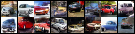
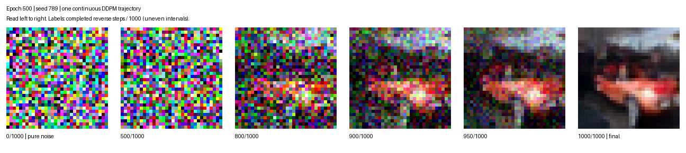

# DDPM：从噪声生成 CIFAR-10 汽车

使用 PyTorch 实现的学习型 DDPM 项目：通过简化 U-Net 预测噪声，学习从高斯噪声生成 **32×32 汽车图片**。仅使用 CIFAR-10 的 automobile 类别，不包含文本条件或类别条件输入。

## 生成结果



第 500 轮权重，种子 42，一次生成 16 张，未逐张筛选。展示有限数量的样本不代表整体生成质量；目前尚未完成 FID 评估。

## 同一张图片的反向去噪过程



第 500 轮权重，种子 789。这是人工选择用于展示的生成轨迹。依次展示完成 0、500、800、900、950、1000 次反向更新后的状态，时间间隔不均匀。原始图片为 32×32，过程图仅做最近邻放大，没有增加图像细节。

## 核心方法

- 数据：CIFAR-10 训练集的 automobile 类别（标签 1），共 5,000 张。
- 输入归一化到 [-1, 1]；网络输入为带噪图片和时间步。
- 网络：带正弦时间编码、跳跃连接和 GroupNorm 的简化 U-Net。
- 目标：预测加入原图的高斯噪声，使用 MSE 损失和 AdamW 优化器。
- 扩散调度：1,000 步，beta 从 0.0001 线性增加到 0.02。
- 采样：DDPM 反向更新，使用 beta 作为反向方差，最后一步不再加入随机噪声。

## 安装

本地测试环境：Windows、Python 3.10.20、PyTorch 2.7.1+cu118、torchvision 0.22.1+cu118、Pillow 12.2.0，显卡为 RTX 4060 Laptop GPU。

可以创建独立环境，不需要安装作者完整的机器人学习环境：

```bash
conda create -n my-ddpm python=3.10
conda activate my-ddpm
```

在项目根目录执行以下命令。CPU 或其他 CUDA 版本的用户应通过 [PyTorch 安装说明](https://pytorch.org/get-started/previous-versions/)选择匹配的安装方式。

```bash
python -m pip install torch==2.7.1 torchvision==0.22.1 --index-url https://download.pytorch.org/whl/cu118
python -m pip install -r requirements.txt
```

## 使用第 500 轮权重

**发布状态：权重尚未上传。** 发布后将在本仓库 Releases 提供 `automobile_epoch_500.pt`。仅克隆源码目前不能直接运行采样，请先取得该权重；不要使用不可信来源的权重文件。

将权重放在：

```text
my-ddpm/
└── checkpoints_continue/
    └── automobile_epoch_500.pt
```

在项目根目录运行：

```bash
python sample.py
```

生成 16 张图并保存为 `automobile_sample.png`。这个脚本未固定随机种子，再次执行会生成不同图片，并覆盖该输出图片，不会改动权重。

### 固定种子生成样例

```bash
python compare_samples.py --epochs 500 --samples 16 --seed 42
```

结果保存在 `comparisons/时间戳/`。使用相同设备、批大小和软件环境有助于复现；跨平台不保证逐像素一致。

### 生成六阶段过程图

```bash
python denoising_process.py --seed 789
```

输出过程 PNG、GIF 和各阶段的原始图片，位于 `comparisons/denoising_时间戳/`。更换 seed 可以更换生成轨迹。

### 比较不同训练轮次

需要另外准备第 200 轮和第 350 轮权重，分别放入 `checkpoints/` 和 `checkpoints_continue/`：

```bash
python compare_samples.py --epochs 200 350 500 --samples 64 --seed 123
```

每个模型使用相同初始噪声和每一步的随机扰动，便于逐张比较。不同种子之间也应保持相同的 samples 和 batch-size；批大小会影响随机数消耗顺序。

## 训练与复现边界

**当前 `train.py` 不是上述第 500 轮权重的完整复现脚本。** 目前配置为从头训练 200 轮、batch size 128、学习率 0.002，每 10 轮保存一次到 `checkpoints/`。它不会自动加载第 200 轮权重继续训练，重复运行可能覆盖该文件夹里的同名权重；请先备份。

项目曾从第 200 轮模型参数继续训练到第 500 轮，续训学习率为 0.0002，AdamW 状态重新初始化。当前代码和仅含模型参数的检查点不足以完整复现历史训练随机状态，不宣称精确复现这次训练。

从头训练前，在项目根目录下载数据：

```bash
python -c "from torchvision.datasets import CIFAR10; CIFAR10(root='./data', train=True, download=True)"
```

确认训练配置和备份后执行 `python train.py`。训练代码会从数据中筛选 automobile 类别。预训练采样不需要下载 CIFAR-10。

## 文件结构

| 文件 | 用途 |
|---|---|
| `model.py` | U-Net、卷积块、时间步编码 |
| `train.py` | 当前从头训练配置 |
| `sample.py` | 使用第 500 轮权重生成图片 |
| `compare_samples.py` | 固定随机噪声比较检查点 |
| `denoising_process.py` | 单张图片的去噪过程 |
| `01_tensor.py` | 张量学习实验 |
| `02_dataset.py` | 数据集读取和可视化实验 |
| `03_noise.py` | 前向加噪实验 |
| `assets/` | README 展示图 |

`02_dataset.py` 和 `03_noise.py` 仍含作者本机的绝对数据路径，使用前需自行修改；这不影响上述主要采样入口。

数据集、检查点、运行输出和本地环境均不纳入 Git；最佳权重拟单独通过 GitHub Release 分发。

## 局限和后续工作

- 32×32 分辨率限制细节表现，部分生成结果仍有车身扭曲和背景混合。
- 精选展示不能代替多种子随机样本或定量评估。
- 后续计划：补充 FID 评估、整理完整训练/续训配置，并探索模型结构改进。

## 学习参考

- [Ho et al., Denoising Diffusion Probabilistic Models (2020)](https://arxiv.org/abs/2006.11239)
- [lucidrains/denoising-diffusion-pytorch](https://github.com/lucidrains/denoising-diffusion-pytorch)

这是学习项目，不是上述仓库或论文的官方实现，也不宣称达到其生成效果。
